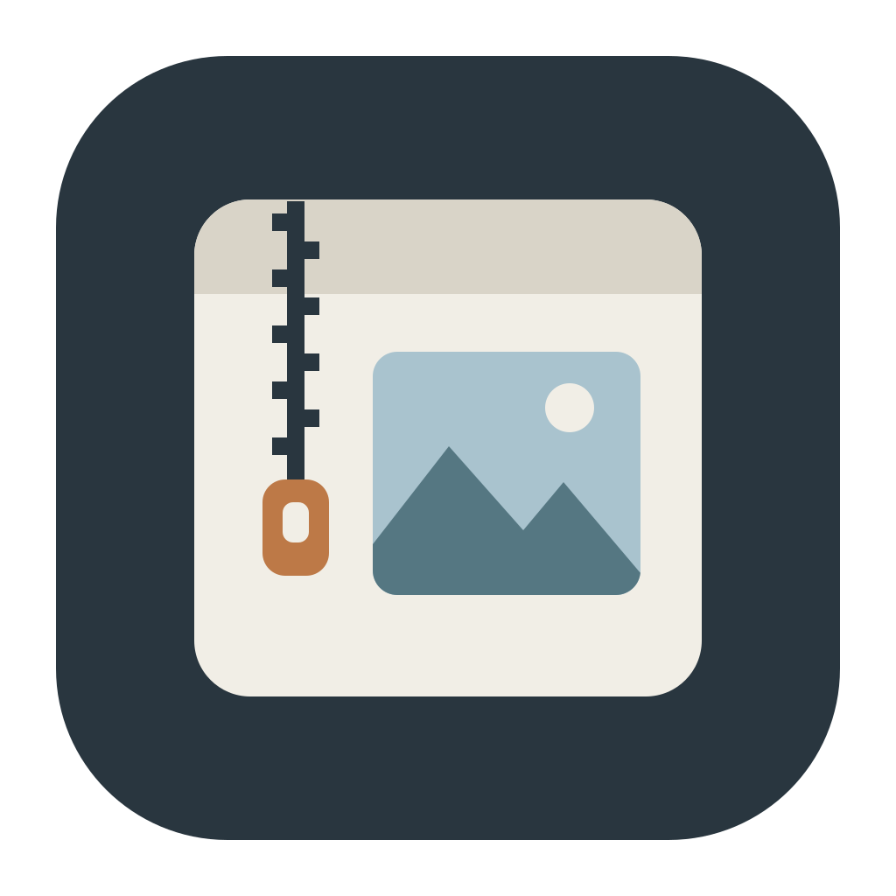
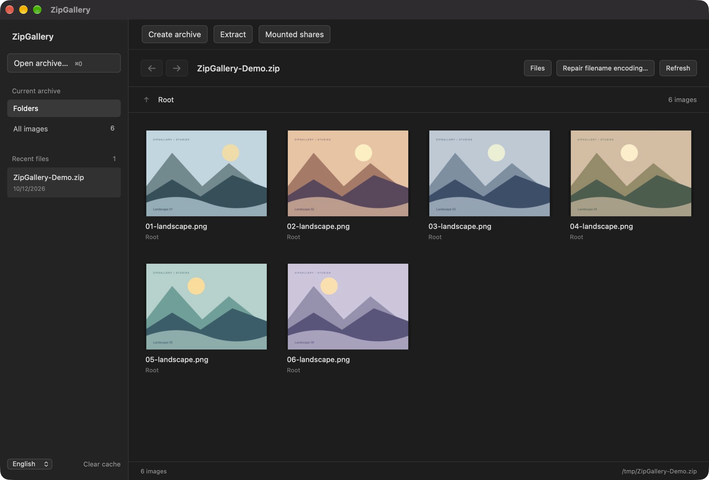
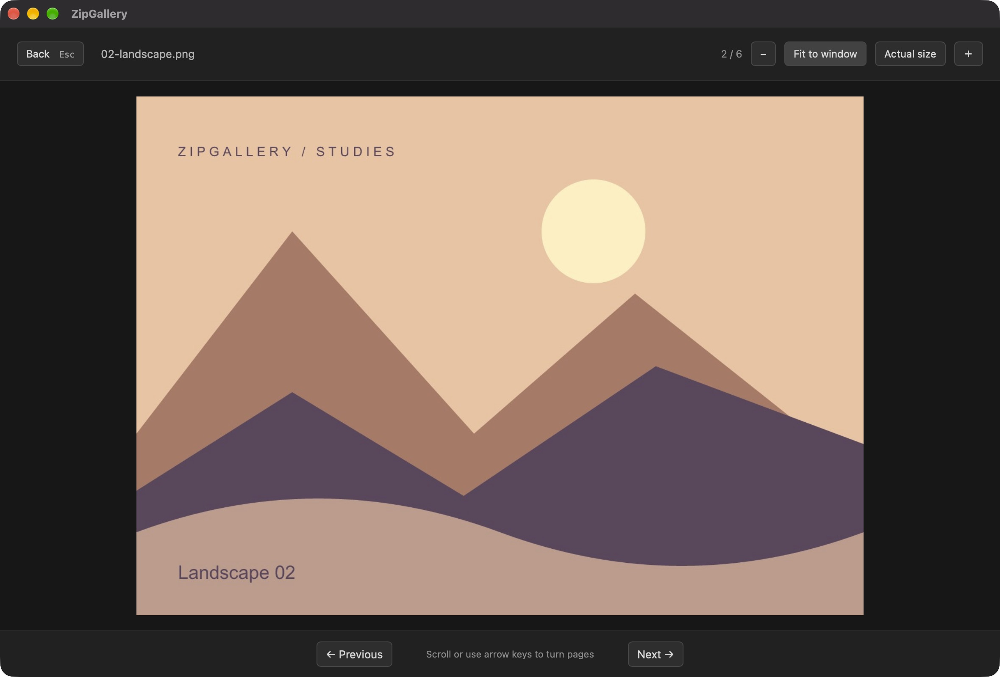
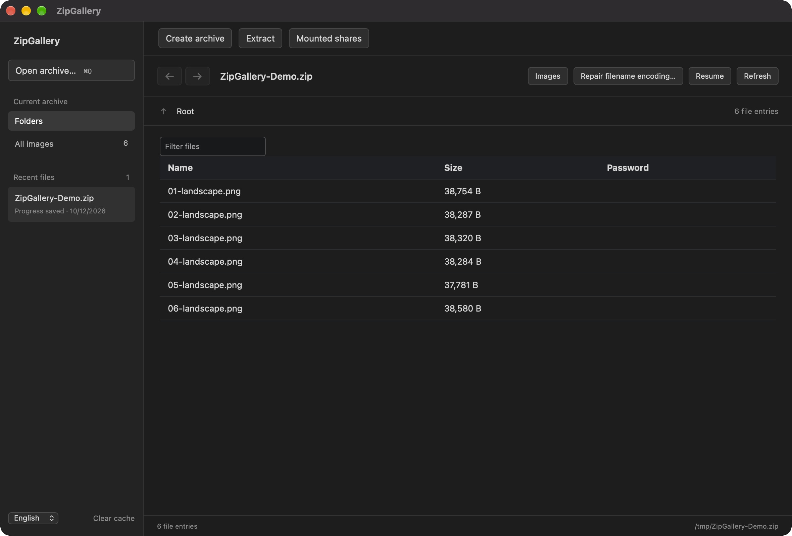

<p align="center"></p>

# ZipGallery

[English](README.md) | **简体中文**

**直接看 ZIP / CBZ 里的图片，也能处理日常压缩与解压。**

ZipGallery 是一款 macOS 压缩包工具：浏览图集时无需先解压整个包；处理普通文件时，可以查看文件列表、创建压缩包或解压。应用已内置 7zz，不需要另外安装 7-Zip。

[下载最新版](https://github.com/DuckFeather10086/ZipGallery/releases/latest) · [使用方法](#快速上手) · [开发文档](docs/DEVELOPMENT.md) · [MIT License](LICENSE)

## 界面预览

**图片网格**：浏览包内图片，保留目录结构，也可切换到全部图片。



**大图阅读**：滚轮或方向键连续翻页，支持适应窗口、实际大小和缩放。



**文件列表**：查看文件名、大小和加密状态，按名称筛选，再按需解压。



截图来自实际运行的应用，展示的是项目生成的合成样本。界面支持简体中文和 English，可在左下角切换。

## 能做什么

- **包内看图**：预览未加密 ZIP / CBZ 中的 JPEG、PNG、WebP，支持自然排序、缩略图、目录导航和大图阅读。
- **连贯翻页**：滚轮和按住方向键都能连续翻页；放大后滚轮用于滚动图片。
- **记住阅读位置**：保存最近 20 个压缩包与阅读进度；本次使用期间可在已打开的包之间后退、前进。
- **普通压缩与解压**：创建 ZIP、7z、tar.gz；查看和解压 7zz 支持的格式，包括 RAR。RAR 仅支持读取和解压，不能创建。
- **密码与任务状态**：ZIP / 7z 创建时可设置密码，解压支持输入密码，任务显示进度并可取消。输出使用新名称，拒绝覆盖已有内容。
- **已挂载 SMB**：使用 macOS 已连接的共享目录打开压缩包，也可向共享保存压缩或解压结果。
- **文件名编码修复**：为旧编码 ZIP / CBZ 预览并另存 UTF-8 副本，保留原包。
- **系统集成**：应用与压缩包文件图标，支持拖入文件及 Finder 的“打开方式”。

## 下载与安装

当前提供 **macOS Apple Silicon（arm64，M 系列芯片）** 安装包。已在 macOS 27.0.1 上验证；暂未提供 Intel Mac、Windows 或 Linux 版本，也未完成旧版 macOS 兼容性验证。

1. 打开 [Releases 下载页](https://github.com/DuckFeather10086/ZipGallery/releases/latest)。
2. 在 **Assets** 中下载 `ZipGallery-版本号-macos-arm64.dmg`。不要把 GitHub 自动生成的 `Source code` 当成安装包。
3. 打开 DMG，把 `ZipGallery.app` 拖到“应用程序”，再从“应用程序”启动。
4. 也可以下载 `ZipGallery-版本号-macos-arm64.app.zip`，解压后将应用移到“应用程序”。两种安装方式任选其一。

**首次启动提示**：当前发行版使用 ad-hoc 签名，尚未进行 Apple Developer ID 签名或公证。如果 macOS 提示无法验证开发者，请先确认文件来自本仓库的 Release；信任此来源后，可按 [Apple 的官方说明](https://support.apple.com/zh-cn/102445)，在尝试启动后进入“系统设置 → 隐私与安全性”，为此应用选择“仍要打开”。

Release 中的 `SHA256SUMS` 可用于核对下载文件。普通使用无需安装 Go、Bun 或额外的压缩内核。

### 设为默认打开程序

在 Finder 中选中一个压缩包，按 `⌘I` 打开“显示简介”，在“打开方式”选择 ZipGallery，再点“全部更改”。对需要的文件格式分别设置一次。

应用声明了 ZIP、CBZ、7z、RAR、tar、gz、bz2、xz、tgz 的打开关联。安装应用不会自动替所有用户修改默认打开方式。

## 快速上手

### 看图集 / 漫画

1. 点击“打开压缩包…”或按 `⌘O`，选择 ZIP / CBZ；也可以把文件拖进窗口。
2. 点击文件夹进入目录，或选择“全部图片”跨目录浏览。
3. 点击缩略图进入大图。适应窗口模式下，滚轮或方向键都可以翻页。
4. 按 `Esc` 返回网格。下次从“最近文件”打开这个包，再点击“继续阅读”即可回到保存的位置。

没有可预览图片的 ZIP，以及 7z、RAR 等其他格式，会进入文件列表。加密压缩包目前使用文件列表和解压流程，不提供加密图片的包内预览。

### 解压 / 新建压缩包

**解压**：打开压缩包 → 点击“解压” → 如有需要填写密码 → 点击“开始” → 选择一个新的输出文件夹名称。任务运行时可查看进度或取消。

**压缩**：点击“新建压缩包” → 选择同一目录下的多个文件，或一个文件夹 → 选择 ZIP / 7z / tar.gz → 按需设置密码 → 点击“开始”并选择新的输出文件名。tar.gz 不提供密码选项。

密码不会写入历史记录。解压拒绝不安全路径和链接；若目标名称已存在，请换一个新名称。

### 使用 SMB 共享

先在 Finder 中通过“前往 → 连接服务器”（`⌘K`）连接 SMB 共享。挂载完成后，点击 ZipGallery 的“已挂载共享”，或在打开、保存对话框中选择该共享目录。

服务器登录由 macOS 管理。ZipGallery 当前不提供应用内 SMB 登录、自动重连或网络超时设置；共享离线时需要先在 Finder 中恢复连接。

### 修复乱码文件名

打开 ZIP / CBZ 后，点击“修复文件名编码…”，选择 GB18030 / GBK、Shift-JIS 或 CP437，检查预览，再保存 UTF-8 副本。

原包保持不变。此功能修复文件名编码，不修复压缩数据损坏，也不能保证恢复已经丢失的名称信息；请以预览结果为准。

### 常用快捷键

- `⌘O`：打开压缩包。
- `←` / `↑` / `PageUp`：上一张；`→` / `↓` / `PageDown`：下一张。
- `0`：适应窗口；`1`：实际大小；`+` / `−`：缩放。
- `Esc`：关闭大图，返回网格。
- `Option + ←` / `Option + →`：切换本次已打开的上一个 / 下一个压缩包。

## 当前限制与常见问题

**为什么图片和原文件的透明效果不同？** 当前预览链路统一输出 JPEG，PNG / WebP 的透明度和精确无损像素不保留；原压缩包和解压出来的文件不会因此改变。动画暂不播放，HEIC / RAW 暂不支持预览。

**超大图片能打开吗？** 单张图片解压输入上限为 96 MiB，像素上限为 2400 万；暂不支持超大图分块。超过限制的条目会显示错误，其他图片仍可浏览。

**更新后怎么安装？** 退出正在运行的 ZipGallery，再用新版本替换“应用程序”里的旧应用。最近记录与缓存保存在用户资料目录；正常替换应用不删除这些数据。目前没有应用内自动更新入口。

**怎样反馈问题？** 请到 [Issues](https://github.com/DuckFeather10086/ZipGallery/issues) 提供应用版本、macOS 版本、压缩格式、是否加密 / 位于 SMB，以及复现步骤。分享样本前请移除个人内容，优先提供最小合成样本。

## 从源码构建

在 macOS 上安装 Go、Bun 和 Xcode Command Line Tools。当前验证的工具版本为 Go 1.27.1、Bun 1.4.2。

```sh
git clone https://github.com/DuckFeather10086/ZipGallery.git
cd ZipGallery
bun install --frozen-lockfile
go mod download
bun run build
```

应用和 DMG 输出到 `build/darwin-arm64/`。开发运行、测试、架构和截图样本生成方法见 [开发文档](docs/DEVELOPMENT.md)，验证记录见 [VALIDATION.md](docs/VALIDATION.md)。

## 许可证

ZipGallery 自身代码、文档和原创 SVG 图标采用 [MIT License](LICENSE)。内置 7zz 和其他第三方依赖保留各自许可证；应用中附带相关声明及 7-Zip 对应源码，详见 [THIRD_PARTY_NOTICES.md](THIRD_PARTY_NOTICES.md)。
